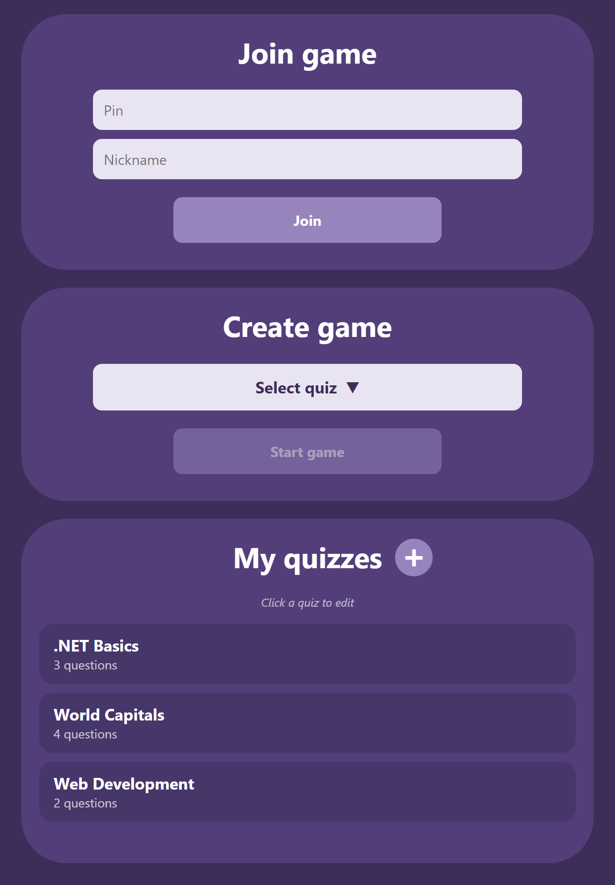
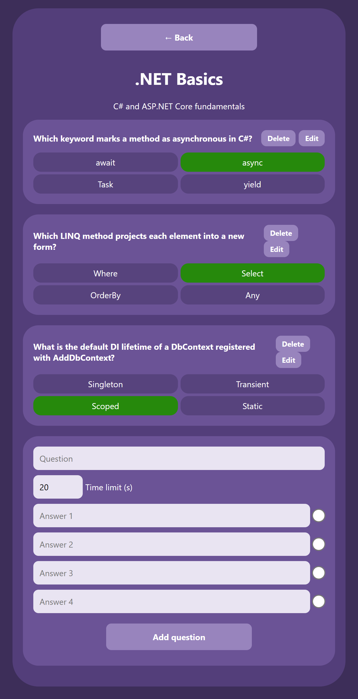
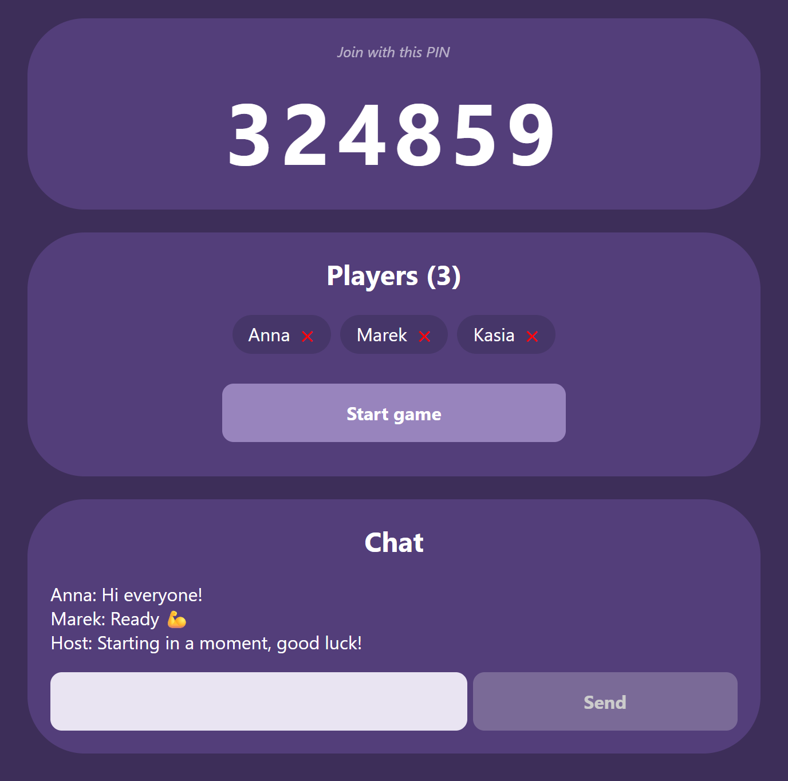
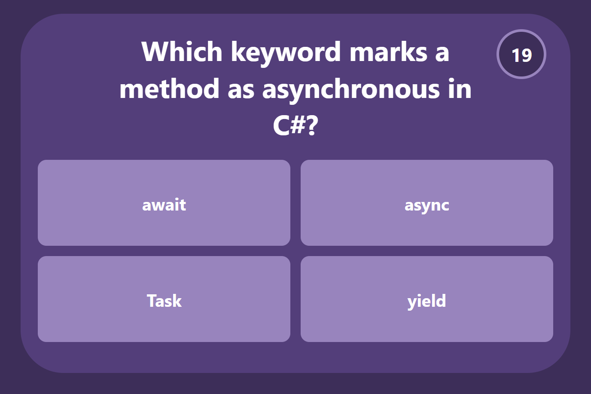
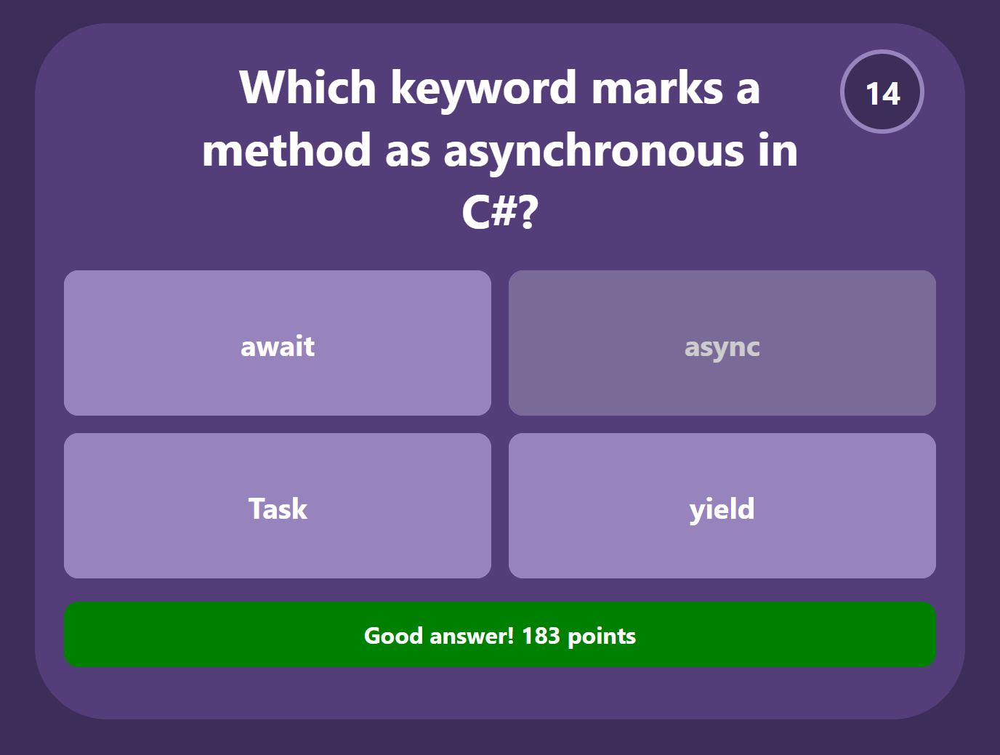
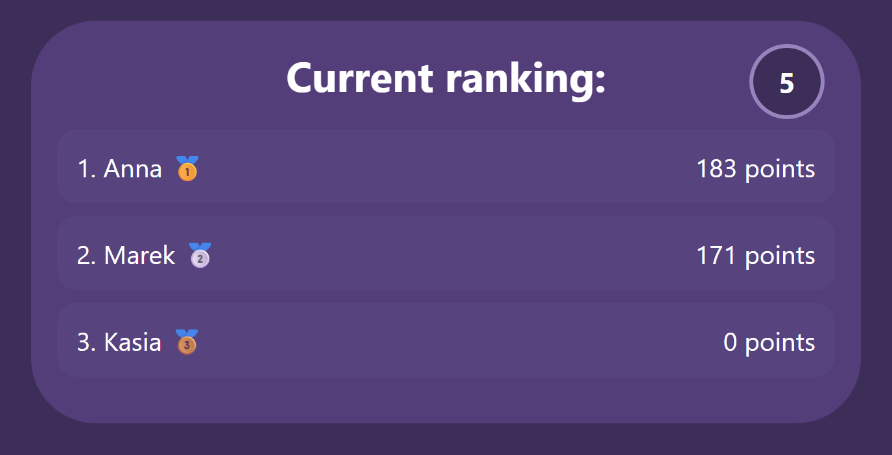
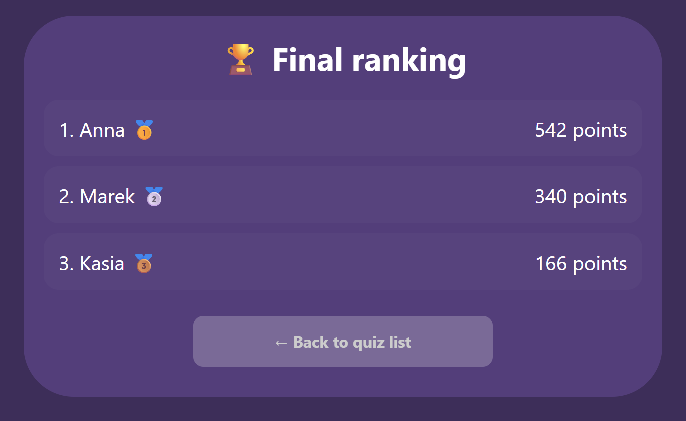

# QuizApp

A real-time multiplayer quiz game in the style of Kahoot. The host picks a quiz and starts a game with a PIN.
Players join from their own devices and answer timed questions, and the ranking updates live after every question.

**Stack:** ASP.NET Core (.NET 10) Web API + SignalR · EF Core + SQLite · React 19 + TypeScript + Vite

## Features

- **Quiz management**: create, edit and delete quizzes and questions (REST API with a Scalar UI in development).
- **Game lobby**: the host creates a game and gets a PIN. Players join with the PIN and a nickname, and the host can
  kick players before the game starts. The lobby has a chat for the host and players.
- **Live gameplay over SignalR**: a 5-second countdown, then the questions are sent to all players at the same time,
  each with its own time limit.
- **Scoring**: a correct answer is worth 100–200 points, and faster answers score more:
  `100 + 100 × (1 − elapsed / timeLimit)`. A wrong or late answer scores 0.
- **Rankings**: the current ranking is shown between questions and the final ranking at the end.
- **Rejoin after refresh**: each player gets a token, so a reloaded page reconnects to the same game.
- **Server-side validation**: the server checks the game state, the host's rights, duplicate nicknames, double answers
  and the time limit.

## Screenshots

| Main screen | Quiz editor |
|---|---|
|  |  |

| Host lobby (PIN, players, chat) | Question on the host screen |
|---|---|
|  |  |

| Player answers | Ranking between questions |
|---|---|
|  |  |

| Final ranking |
|---|
|  |

## Project structure

```
Quiz.Api/            ASP.NET Core backend
  Controllers/       REST: /api/quizzes, /api/quizzes/{id}/questions
  Hubs/GameHub.cs    SignalR hub (/hubs/game): create/join/rejoin, start, answer, chat, kick
  Game/              in-memory game sessions (GameStore) and the game loop (GameRunner)
  Data/, Models/     EF Core DbContext and entities (Quiz, Question, Answer)
  Migrations/        EF Core migrations
quiz-client/         React + TypeScript frontend (Vite)
```

## Running locally

Requirements: .NET 10 SDK, Node.js, and the EF Core CLI (`dotnet tool install --global dotnet-ef`).

```bash
# Backend (http://localhost:5149)
cd Quiz.Api
dotnet ef database update   # creates quiz.db (SQLite)
dotnet run

# Frontend (http://localhost:5173), in a second terminal
cd quiz-client
npm install
npm run dev
```

The Vite dev server proxies `/api` and `/hubs` (WebSocket) to the backend. In development the API docs are at
`http://localhost:5149/scalar`.

## How to play

1. Create a quiz and add questions with answers, marking the correct ones.
2. Open the quiz and start a game. Share the PIN with the players.
3. Players open the app, enter the PIN and a nickname, and wait in the lobby.
4. The host starts the game, and the player with the most points wins.
